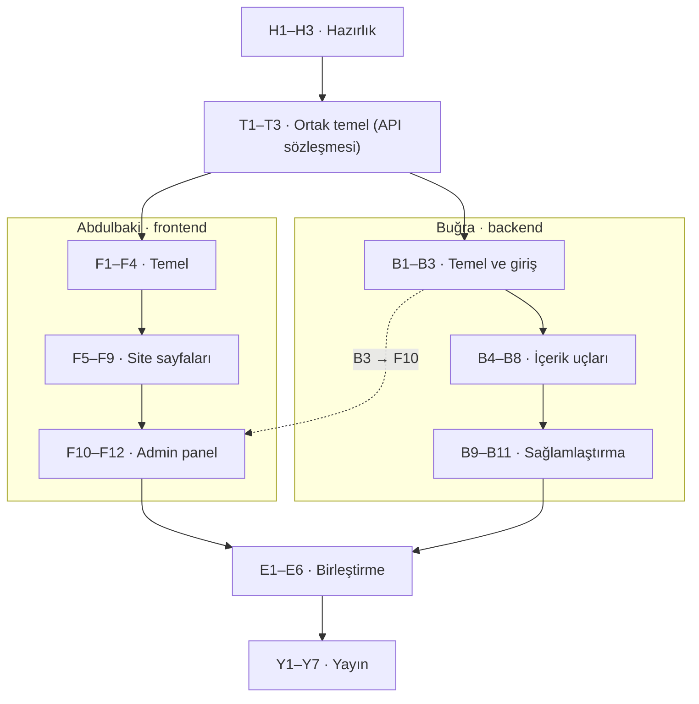

# rootandadmin — Görev Planı

> Bu dosya Claude Docs'taki "rootandadmin — Görev Planı" dokümanının kopyasıdır. Plan değişirse ikisini birlikte güncelleyin. Görevler GitHub Projects panosunda issue olarak takip edilir.

Oct 11, 2026 · @Abdulbaki İMSAL

## Nasıl okunur

Plan tarihe göre değil, görev sırasına göre ilerliyor: bir görev ancak bağlı olduğu görevler bitince başlar. Abdulbaki frontend ve admin panel arayüzünü, Buğra backend'i üstleniyor. Ortak görevleri ikiniz birlikte yapıyorsunuz.

| Kod | Anlamı | Sorumlu |
| --- | --- | --- |
| H | Hazırlık (Faz 0) | İkisi |
| T | Ortak temel (Faz 1) | İkisi |
| F | Frontend (Faz 2A) | Abdulbaki |
| B | Backend (Faz 2B) | Buğra |
| E | Birleştirme (Faz 3) | Görevde yazıyor |
| Y | Yayın (Faz 4) | Görevde yazıyor |

Her görev kartı aynı düzende: **Ne** (amaç), **Bağlı** (önce bitmesi gerekenler), **Nasıl** (adımlar), **Bitti sayılır** (işaretlenecek kontrol listesi). Her görev GitHub'da bir issue olur, kendi branch'inde yapılır ve diğer kişinin onayladığı bir PR ile `dev`'e birleşir.

Bir görev şu dört şart sağlanınca biter:

1. Kabul kriterlerinin hepsi işaretli.
2. Kod yerelde hatasız çalışıyor, `npm run lint` ve varsa testler geçiyor.
3. PR diğer kişi tarafından onaylandı ve `dev`'e birleşti.
4. Yeni bir ortam değişkeni eklendiyse `.env.example` güncellendi.

## Faz 0 — Hazırlık

Kod yazmadan önce ikinizin de aynı araçlarla, aynı repoya erişebilir olması gerekiyor. Bu fazda kod yok, sadece kurulum var.

### H1 · Yerel geliştirme ortamı

**Ne:** İkinizin bilgisayarında projeyi çalıştırabilecek ortam. **Bağlı:** —

1. Node.js 22 LTS kurun (nodejs.org). Kontrol: `node -v` 22.x göstermeli.
2. Git kurun ve kimliğinizi ayarlayın: `git config --global user.name "Ad Soyad"`, `git config --global user.email "..."`.
3. VS Code eklentileri: ESLint, Prettier, Tailwind CSS IntelliSense, Prisma, GitLens.
4. Repoyu klonlayın: `git clone https://github.com/bakimsal/rootandadmin.git`, sonra `git checkout dev`.

**Bitti sayılır:**

- [ ] İkiniz de `dev` branch'ini klonladınız
- [ ] `node -v` ve `git --version` çalışıyor

### H2 · Ücretsiz servis hesapları

**Ne:** Yayın ve veri için gereken dört hesap. **Bağlı:** —

1. Hepsini **GitHub hesabıyla** açın: Vercel, Render, Neon, Cloudinary. Tek tıkla giriş ve repo bağlama kolaylaşır.
2. Hesapları Abdulbaki açsın, Buğra'yı ekip üyesi olarak eklesin. Neon ve Cloudinary'de ikinizin de erişimi olsun.
3. Neon'da `rootandadmin` adında proje oluşturun, bölge olarak **Frankfurt (eu-central-1)** seçin. Türkiye'ye en yakın bölge bu.
4. Neon'da iki branch açın: `main` (yayın) ve `dev` (geliştirme). Her birinin bağlantı adresini not edin.
5. Şifreleri ve anahtarları birbirinize özel mesajla iletin. Repoya, issue'ya veya bu dokümana yazmayın.

**Bitti sayılır:**

- [ ] Dört hesap açık, ikiniz de erişebiliyorsunuz
- [ ] Neon'da `main` ve `dev` veritabanı branch'leri var

### H3 · Repo kuralları ve pano

**Ne:** Kimsenin yanlışlıkla `main`'i bozamayacağı düzen ve görevlerin takip edileceği pano. **Bağlı:** —

1. GitHub'da Settings → Branches → "Add rule": `main` ve `dev` için "Require a pull request before merging" ve "Require approvals: 1" açın.
2. Projects → New project → **Board** şablonu, adı `rootandadmin`. Sütunlar: Yapılacak, Devam ediyor, İncelemede, Bitti.
3. Bu dokümandaki her görevi bir issue olarak açın. Başlıkta kodunu kullanın ("F3 · Ortak düzen"), etiket olarak `frontend`, `backend` veya `ortak` ekleyin.
4. Etiketler: `frontend`, `backend`, `ortak`, `hata`, `güvenlik`.

**Bitti sayılır:**

- [ ] `main` ve `dev` korumalı, doğrudan push reddediliyor
- [ ] Panoda tüm görevler issue olarak duruyor

## Faz 1 — Ortak temel

Yeni siber tasarım menüyü Haberler, Bloglar, Projeler ve İletişim olarak değiştirdi. Bu yüzden repodaki API sözleşmesi taslak olarak eskidi. Paralel çalışmaya geçmeden önce ikiniz birlikte sözleşmeyi kesinleştiriyorsunuz. Bu fazda ne kadar net olursanız, Faz 3'teki birleştirme o kadar kısa sürer.

### T1 · Veri modelini kesinleştir

**Ne:** Sitede hangi içerik türlerinin olacağı ve her birinin alanları. **Bağlı:** —

1. Aşağıdaki modeli birlikte gözden geçirin, eksik ya da fazla alanı tartışın.
2. Kararları `docs/api-sozlesmesi.md` dosyasının "Veri modeli" bölümüne işleyin.

| Model | Alanlar | Not |
| --- | --- | --- |
| Post | `type` (NEWS / BLOG), `title`, `slug`, `excerpt`, `content` (Markdown), `coverImage`, `status` (DRAFT / PUBLISHED / SCHEDULED), `publishedAt`, `readingTime`, `severity` (CRITICAL / HIGH / INFO, sadece haberde), `category`, `tags`, `author`, `metaTitle`, `metaDescription` | Haber ve blog aynı tabloda, `type` ile ayrılıyor |
| Category | `name`, `slug` | Haber filtresi: zafiyet, saldırı, araç |
| Tag | `name`, `slug` | Serbest etiketler |
| Project | `name`, `slug`, `description`, `language`, `repoUrl`, `demoUrl`, `featured`, `order` | Projeler sayfası ve ana sayfa kartları |
| Author | `name`, `slug`, `role`, `bio`, `avatarUrl`, `linkedinUrl`, `githubUsername` | Ekip kartları ve yazar sayfaları |
| User | `email`, `passwordHash`, `author` | Admin girişi, bir yazara bağlı |
| ContactMessage | `name`, `email`, `message`, `createdAt`, `read` | İletişim formu, admin panelden okunur |

Canlı akış şeridi ayrı bir tablo değil. Son yayınlanan haber, blog ve projelerden otomatik oluşuyor.

**Bitti sayılır:**

- [ ] Model tablosu ikinizin onayıyla sözleşmeye işlendi
- [ ] Sözleşmenin sonundaki açık sorular cevaplandı

### T2 · API uç noktalarını kesinleştir

**Ne:** Frontend'in backend'den ne isteyeceği ve ne alacağı. **Bağlı:** T1

1. Mevcut taslaktaki uç noktaları yeni modele göre güncelleyin:
   - `GET /api/posts?type=NEWS&category=zafiyet&page=1`
   - `GET /api/posts/:slug`, `GET /api/projects`, `GET /api/authors`, `GET /api/feed` (canlı akış için son 8 kayıt)
   - `POST /api/contact` (iletişim formu)
   - Admin tarafında posts, projects, authors, contact-messages için CRUD
2. Her uç nokta için bir örnek JSON yanıtı yazın. Frontend'in sahte verisi bu örneklerden üretilecek.
3. TypeScript tiplerini `frontend/src/types/api.ts` dosyasına yazın. Backend'deki Zod şemaları bu tiplerle birebir aynı olacak.

**Bitti sayılır:**

- [ ] Sözleşmede her uç noktanın isteği, yanıtı ve hata kodları var
- [ ] `api.ts` PR'ı ikinizin onayıyla birleşti

### T3 · Tasarım kararlarını sabitle

**Ne:** Seçilen siber tasarımın kod tarafında tek kaynakta durması. **Bağlı:** —

1. Figma'daki renk değişkenlerini ve fontları `CLAUDE.md`'nin "Tasarım" bölümüne yazın: zemin `#000000`, yeşil `#17B85C`, mavi `#0B93D3`, kritik `#E5484D`, yüksek `#E5A50A`; fontlar Chakra Petch, IBM Plex Sans, JetBrains Mono.
2. Eski A, B, C tasarım yönlerinin vazgeçildiğini not edin. Referans: Figma'daki "rootandadmin — Tasarım" dosyası.
3. Henüz tasarlanmamış ekranları listeleyin: yazı detay, haber listesi, proje detayı, iletişim, admin panel.

**Bitti sayılır:**

- [ ] `CLAUDE.md` güncel tasarımı anlatıyor
- [ ] Eksik ekranların listesi panoda issue olarak var

## Faz 2A — Frontend (Abdulbaki)

Frontend, backend hazır olmadan sahte veriyle ilerliyor. Gerçek API'ye geçiş Faz 3'te tek bir ayarla yapılıyor. Okuyucu sayfaları sunucuda önceden üretiliyor, admin panel tarayıcıda çalışıyor.

### F1 · Next.js iskeleti

**Ne:** `frontend/` klasöründe çalışan boş bir Next.js uygulaması. **Bağlı:** H1

1. `frontend/README.md`'deki `create-next-app` komutunu çalıştırın (TypeScript, Tailwind, App Router, `src/` klasörü).
2. README'deki klasör yapısını boş dosyalarla oluşturun: `app/(site)`, `app/admin`, `components/ui`, `lib`, `types`.
3. Prettier ekleyin: `npm i -D prettier prettier-plugin-tailwindcss`, `.prettierrc` dosyası oluşturun.
4. `.env.example`'ı `.env.local` olarak kopyalayın.

**Bitti sayılır:**

- [ ] `npm run dev` ile `localhost:3000` açılıyor
- [ ] `npm run lint` ve `npm run build` hatasız

### F2 · Tasarım sistemi

**Ne:** Renkler, fontlar ve temel bileşenler tek yerde. Sayfalar bunları kullanır, kendi rengini uydurmaz. **Bağlı:** F1, T3

1. `globals.css` içinde Tailwind'in `@theme` bloğuna Figma'daki değişkenleri aynı isimlerle yazın: `--color-bg-base`, `--color-accent-green`, `--color-status-critical` gibi.
2. Fontları `next/font/google` ile yükleyin (Chakra Petch, IBM Plex Sans, JetBrains Mono). Bu sayede fontlar sitenin kendisinden sunulur, ek istek olmaz.
3. `components/ui` altına temel bileşenleri yazın: `Button` (birincil / ikincil), `SeverityBadge` (kritik / yüksek / bilgi), `SectionHeader` ("01 / HABERLER" başlığı), `Card`.
4. Bileşenleri denemek için geçici bir `/dev/ui` sayfası yapın, yayına almadan silin.

**Bitti sayılır:**

- [ ] Kodda elle yazılmış renk kodu (hex) yok, hepsi tema değişkeninden geliyor
- [ ] Bileşenler Figma'daki hallerine benziyor

### F3 · Ortak düzen

**Ne:** Her sayfada görünen üst ve alt kısımlar. **Bağlı:** F2

1. `CanliAkis`: kayan haber şeridi. CSS animasyonu, fareyle üzerine gelince durur.
2. `Header`: logo, menü (Haberler, Bloglar, Projeler, İletişim), arama butonu. Telefonda menü açılır panel olur.
3. `Footer`: ekip kartları (fotoğraf, rol, biyografi, LinkedIn, GitHub) ve alt çubuk.
4. Bunları `app/(site)/layout.tsx` içinde birleştirin.

**Bitti sayılır:**

- [ ] 375 px (telefon) ve 1440 px genişlikte düzgün görünüyor
- [ ] Menü klavyeyle (Tab) gezilebiliyor

### F4 · Veri katmanı ve sahte veri

**Ne:** Sayfalar veriyi tek bir dosyadan alır. Bu dosya şimdilik sahte veri döner, Faz 3'te gerçek API'ye geçer. **Bağlı:** F1, T2

1. `lib/mock/` altına T2'deki örnek JSON'lardan en az 12 haber, 8 blog, 4 proje, 2 yazar oluşturun.
2. `lib/api.ts` içinde `getPosts`, `getPost`, `getProjects`, `getAuthors`, `getFeed` fonksiyonlarını yazın. `USE_MOCK_DATA=true` ise sahte veriyi, değilse backend'i kullansınlar.
3. Fonksiyonların döndürdüğü tipler `types/api.ts`'den gelsin.

**Bitti sayılır:**

- [ ] Hiçbir sayfa veriyi doğrudan `fetch` ile çekmiyor, hepsi `lib/api.ts`'i kullanıyor

### F5 · Ana sayfa

**Ne:** Figma'daki ana sayfanın kodu. **Bağlı:** F3, F4

1. Hero: yazılan `whoami` komutu, başlık, iki buton, sağda satırları sırayla beliren terminal penceresi.
2. Son Haberler: 3 kart ve kategori filtresi. Filtre adres çubuğuna yazılsın (`?kategori=zafiyet`), paylaşılabilir olsun.
3. Bloglar: öne çıkan yazı ve 4 satırlık liste. Projeler: 3 kart.
4. Sayfayı önceden üretilecek şekilde yazın (`export const revalidate = 3600`).

**Bitti sayılır:**

- [ ] Figma ile yan yana konunca belirgin fark yok
- [ ] `npm run build` çıktısında ana sayfa "static" ya da "ISR" olarak görünüyor

### F6 · Haber ve blog liste sayfaları

**Ne:** `/haberler` ve `/bloglar` sayfaları. **Bağlı:** F4

1. Haberlerde seviye (kritik / yüksek / bilgi) ve kategori filtresi, bloglarda etiket filtresi.
2. Sayfa başına 12 kayıt, alt kısımda sayfalama (`?sayfa=2`).
3. Sonuç yoksa boş durum mesajı.

**Bitti sayılır:**

- [ ] Filtre ve sayfa numarası adres çubuğunda, geri tuşu doğru çalışıyor

### F7 · Yazı detay sayfası

**Ne:** Bir haberin ya da bloğun okunduğu sayfa. Sitenin en çok okunacak yeri. **Bağlı:** F4

1. Markdown'ı HTML'e çevirmek için `unified` zinciri: `remark-parse`, `remark-gfm` (tablolar), `remark-rehype`, `rehype-sanitize`, `rehype-pretty-code` (Shiki ile kod renklendirme), `rehype-slug`.
2. **Güvenlik:** `rehype-sanitize` zorunlu. Markdown içine yazılan zararlı bir `` içeren bir test yazısında uyarı çıkmıyor
- [ ] Uzun kod satırları telefonda sayfayı taşırmıyor, kendi kutusunda kayıyor

### F8 · Projeler, iletişim, yazar ve arama

**Ne:** Kalan herkese açık sayfalar. **Bağlı:** F4

1. `/projeler`: tüm proje kartları, GitHub ve demo linkleri.
2. `/iletisim`: ad, e-posta, mesaj formu. Botlara karşı görünmez bir tuzak alanı (honeypot) ekleyin. Form Faz 3'e kadar sahte başarı mesajı gösterir.
3. `/yazar/[slug]`: yazar bilgisi ve yazıları.
4. `/ara?q=...`: arama sonuçları. Header'daki arama butonu ve `⌘K` kısayolu buraya yönlendirir.
5. `not-found.tsx`: terminal temalı 404 sayfası.

**Bitti sayılır:**

- [ ] Menüdeki her link çalışıyor, kırık sayfa yok

### F9 · Animasyonlar ve erişilebilirlik

**Ne:** Figma'da sabit duran hareketlerin koda dökülmesi. **Bağlı:** F5

1. Canvas'taki tasarımda kullanılan CSS animasyonlarını taşıyın: kayan şerit, logo glitch'i, imleç, yazılan komut, terminal satırları, dönen halka.
2. Hepsini `@media (prefers-reduced-motion: reduce)` altında kapatın. Hareket hassasiyeti olan kişiler için zorunlu.
3. Odak çerçevelerini görünür yapın, renk kontrastını kontrol edin (yazı en az 4.5:1).

**Bitti sayılır:**

- [ ] Lighthouse erişilebilirlik puanı 90 ve üzeri
- [ ] İşletim sisteminde "hareketi azalt" açıkken animasyonlar duruyor

### F10 · Admin: giriş ve korumalı düzen

**Ne:** `/admin` altına sadece giriş yapanın girebilmesi. **Bağlı:** F2, T2

1. `next.config.ts` içinde `rewrites` ile `/api/:path*` isteklerini backend'e yönlendirin. **Neden:** site Vercel'de, backend Render'da, yani farklı alan adlarında. Tarayıcılar başka alan adının çerezini engelliyor. Yönlendirme sayesinde oturum çerezi sitenin kendi alan adında kalır.
2. `/admin/giris`: e-posta ve şifre formu, hatalı girişte genel bir mesaj ("bilgiler hatalı"; hangisinin yanlış olduğunu söylemeyin).
3. `middleware.ts`: çerez yoksa `/admin/*` isteklerini girişe yönlendirsin. Asıl yetki kontrolü backend'de; bu sadece kullanıcı deneyimi için.
4. Admin düzeni: sol menü (Yazılar, Projeler, Mesajlar, Profil), sağ üstte çıkış.

**Bitti sayılır:**

- [ ] Giriş yapmadan `/admin/yazilar` açılınca giriş sayfasına düşülüyor

### F11 · Admin: yazı yönetimi

**Ne:** Haber ve blog ekleme, düzenleme, silme. Admin panelin asıl işi. **Bağlı:** F10, F7

1. Liste: tür, durum ve arama filtresiyle tablo; her satırda düzenle ve sil (silmeden önce onay).
2. Editör: solda Markdown, sağda canlı önizleme. Önizleme F7'deki aynı Markdown işleyicisini kullanır, böylece gördüğünüz sitede çıkanla aynı olur.
3. Alanlar: tür, başlık, slug (başlıktan otomatik, düzenlenebilir), özet, kapak görseli, seviye (sadece haberde), kategori, etiketler, durum, yayın tarihi, okuma süresi (otomatik, elle değiştirilebilir), SEO başlığı ve açıklaması.
4. Görsel yükleme: sürükle bırak, yükleme sırasında ilerleme, en fazla 5 MB.
5. Kaydedilmemiş değişiklik varken sayfadan çıkarken uyarı.

**Bitti sayılır:**

- [ ] Bir taslak oluşturulup kaydedilebiliyor, sonra yayına alınabiliyor

### F12 · Admin: projeler, mesajlar, profil

**Ne:** Kalan admin ekranları. **Bağlı:** F10

1. Projeler: ekle, düzenle, sil, sıralamayı değiştir, "öne çıkar" işareti.
2. Mesajlar: iletişim formundan gelenler, okundu işareti.
3. Profil: ad, rol, biyografi, fotoğraf, LinkedIn ve GitHub. Ekip kartları buradan beslenir.

**Bitti sayılır:**

- [ ] Profilde değişen bilgi ana sayfadaki ekip kartında görünüyor (Faz 3'ten sonra)

## Faz 2B — Backend (Buğra)

Backend sözleşmedeki uç noktaları birebir uygular. Bir güvenlik bloğu olduğumuz için giriş, yükleme ve form uçları özellikle sıkı tutuluyor. Her uç nokta çalışır hale gelince Abdulbaki'ye haber verin.

### B1 · Fastify iskeleti

**Ne:** `backend/` klasöründe ayakta duran boş bir API. **Bağlı:** H1

1. `backend/README.md`'deki kurulum komutlarını çalıştırın, klasör yapısını oluşturun (`plugins/`, `modules/`, `lib/`).
2. `src/config.ts`: ortam değişkenlerini Zod ile doğrulayın. Eksik ya da hatalı bir değişken varsa sunucu hiç başlamasın, hatayı açıkça yazsın.
3. `GET /api/health`: `{ "status": "ok" }` dönsün. Render bunu sunucunun ayakta olup olmadığını anlamak için kullanacak.
4. Fastify'ın dahili log'unu açın, geliştirmede okunaklı olsun (`pino-pretty`).

**Bitti sayılır:**

- [ ] `npm run dev` ile `localhost:4000/api/health` cevap veriyor
- [ ] `DATABASE_URL` silinince sunucu anlaşılır bir hatayla duruyor

### B2 · Veritabanı şeması

**Ne:** T1'deki modelin Prisma şeması ve başlangıç verisi. **Bağlı:** B1, T1

1. `prisma/schema.prisma`'ya T1'deki modelleri yazın. Bunlara ek olarak oturumlar için bir `Session` modeli: `id`, `userId`, `expiresAt`.
2. `slug` alanlarına `@unique`, sık filtrelenen alanlara (`type`, `status`, `publishedAt`) indeks ekleyin.
3. Neon'un `dev` branch adresiyle `npm run db:migrate` çalıştırın.
4. `prisma/seed.ts`: iki admin kullanıcı, iki yazar profili, üç kategori (zafiyet, saldırı, araç) ve birkaç örnek yazı. Admin şifreleri koda yazılmasın, `.env`'den okunsun.

**Bitti sayılır:**

- [ ] `npx prisma studio` ile tablolar ve örnek veri görünüyor
- [ ] Migration dosyaları repoda, `.env` repoda değil

### B3 · Admin girişi

**Ne:** Güvenli giriş, çıkış ve oturum kontrolü. **Bağlı:** B2

1. Şifreleri `argon2` ile hash'leyin. Düz metin şifre hiçbir yerde durmasın.
2. Girişte veritabanına rastgele bir oturum kimliği kaydedin (`crypto.randomBytes(32)`), bunu çerez olarak gönderin. JWT yerine bu yöntemi seçtik, çünkü çıkışta oturum gerçekten silinebiliyor.
3. Çerez ayarları: `httpOnly`, `secure` (yayında), `sameSite: 'lax'`, 7 gün geçerli. `domain` vermeyin. Frontend istekleri kendi alan adı üzerinden ilettiği için (F10) çerez orada kalır.
4. Giriş uç noktasına `@fastify/rate-limit`: aynı IP'den 15 dakikada en fazla 5 deneme.
5. Hatalı girişte her zaman aynı mesaj: "E-posta veya şifre hatalı". Kullanıcının var olup olmadığı belli olmasın.
6. `/api/admin/*` uçlarının hepsine oturum kontrolü ekleyin (Fastify `preHandler`). Veri değiştiren isteklerde `Origin` başlığının `FRONTEND_URL` olduğunu da kontrol edin.

**Bitti sayılır:**

- [ ] 6. hatalı denemede 429 hatası dönüyor
- [ ] Çıkıştan sonra eski çerezle admin uçları 401 veriyor

### B4 · Yazı uç noktaları

**Ne:** Haber ve blogların listelenmesi, okunması ve yönetimi. **Bağlı:** B2, B3, T2

1. Herkese açık liste ve detay: sadece `status = PUBLISHED` ve `publishedAt <= şimdi` olanlar dönsün. Zamanlanmış yazılar bu sayede ek bir zamanlayıcı olmadan, tarihi gelince kendiliğinden görünür.
2. Listede filtreler (`type`, `category`, `severity`, `tag`, `author`) ve sayfalama (`page`, en fazla 50 kayıt). Listede `content` dönmesin, sayfa hızı için.
3. Slug üretimi: `slugify(title, { locale: 'tr', lower: true, strict: true })`. Aynı slug varsa sonuna `-2`, `-3` ekleyin.
4. Okuma süresi: kelime sayısı / 200, yukarı yuvarlanmış. `readingTimeManual` açıksa elle girilen değer korunur.
5. Admin CRUD: tüm durumları görebilir, oluşturur, kısmi günceller (PATCH), siler. Her gelen veri Zod şemasından geçer.

**Bitti sayılır:**

- [ ] Taslak ve tarihi gelmemiş yazılar herkese açık uçlarda görünmüyor
- [ ] "Şifreleme Çıkmazları" başlığı `sifreleme-cikmazlari` slug'ını üretiyor

### B5 · Kategori, etiket, proje ve yazar uçları

**Ne:** Yazılar dışındaki içeriğin uç noktaları. **Bağlı:** B2, B3

1. Herkese açık: kategoriler ve etiketler (her biri yazı sayısıyla), projeler (`order` sırasıyla), yazarlar.
2. Admin: hepsi için oluştur, güncelle, sil. Bir yazar yalnızca kendi profilini güncelleyebilsin.

**Bitti sayılır:**

- [ ] Sözleşmedeki tüm bu uçlar örnek yanıtlarla aynı biçimde dönüyor

### B6 · Canlı akış ve arama

**Ne:** Ana sayfadaki kayan şerit ve arama sayfasının verisi. **Bağlı:** B4

1. `GET /api/feed`: son 8 yayınlanmış haber, blog ve proje güncellemesi, etiketleriyle (KRİTİK, HABER, BLOG, PROJE).
2. Arama için PostgreSQL'in kendi tam metin aramasını kullanın, ek servis gerekmez. `turkish` dil ayarıyla başlık, özet ve içerik aranır.
3. Hız için elle yazılmış bir migration ile GIN indeksi ekleyin. Sorgu `prisma.$queryRaw` ile, parametreli yazılır (asla metin birleştirerek değil).

**Bitti sayılır:**

- [ ] "zafiyet" araması "zafiyetler" geçen yazıyı da buluyor
- [ ] Aramaya `'; DROP TABLE` yazılınca hata değil, boş sonuç dönüyor

### B7 · Görsel yükleme

**Ne:** Admin panelden kapak görseli ve profil fotoğrafı yüklenmesi. **Bağlı:** B3

1. `@fastify/multipart` ile en fazla 5 MB, tek dosya.
2. Dosya türünü uzantıdan değil, dosyanın ilk baytlarından kontrol edin (`file-type` paketi). Sadece jpg, png, webp kabul.
3. Cloudinary SDK ile `rootandadmin/` klasörüne yükleyin, geriye `{ url, width, height }` dönün.

**Bitti sayılır:**

- [ ] Adı `.jpg` olan bir `.exe` reddediliyor
- [ ] 6 MB'lık görsel 413 hatası veriyor

### B8 · İletişim formu

**Ne:** Ziyaretçi mesajlarının kaydedilmesi ve admin panelde okunması. **Bağlı:** B2

1. `POST /api/contact`: Zod ile doğrulama, mesaj en fazla 2000 karakter.
2. Tuzak alan doluysa mesajı kaydetmeyin ama başarılı yanıt verin. Böylece botlar yakalandıklarını anlamaz.
3. Aynı IP'den saatte en fazla 3 mesaj.
4. Admin: mesaj listesi, okundu işaretleme, silme.

**Bitti sayılır:**

- [ ] 4. mesajda 429 dönüyor, tuzak alan dolu mesajlar veritabanında yok

### B9 · Güvenlik sıkılaştırma

**Ne:** Tüm API'yi kapsayan koruma katmanı. **Bağlı:** B1 (Faz 3'ten önce bitmeli)

1. `@fastify/helmet`: güvenlik başlıkları.
2. `@fastify/cors`: sadece `FRONTEND_URL`'e izin, `credentials: true`.
3. Genel istek limiti (dakikada 100) ve istek gövdesi sınırı (1 MB, yükleme hariç).
4. Hata yönetimi: yayında hata ayrıntısı ve satır numarası asla kullanıcıya gösterilmesin, sadece log'a yazılsın. Yanıt her zaman sözleşmedeki hata biçiminde.

**Bitti sayılır:**

- [ ] Başka bir siteden yapılan istek CORS hatası alıyor
- [ ] Bilerek tetiklenen bir hata kullanıcıya sadece `INTERNAL` kodu dönüyor

### B10 · Sayfa yenileme tetikleyicisi

**Ne:** Bir yazı yayınlanınca sitedeki önceden üretilmiş sayfaların hemen güncellenmesi. **Bağlı:** B4

1. Yayınlanan bir yazı oluşturulduğunda, güncellendiğinde ya da silindiğinde frontend'in `/api/revalidate` ucunu çağırın (sözleşmede yazıyor).
2. İstek başarısız olursa admin işlemi yine de başarılı sayılsın, hata sadece log'a yazılsın.

**Bitti sayılır:**

- [ ] Frontend kapalıyken yazı kaydetmek hata vermiyor

### B11 · Testler

**Ne:** Kritik davranışların otomatik testleri. **Bağlı:** B4

1. `vitest` kurun. Fastify'ın `app.inject()` özelliğiyle sunucuyu gerçekten açmadan istek atın.
2. Testler için Neon'da ayrı bir `test` branch'i kullanın, `dev` verisi bozulmasın.
3. En az şunları test edin: hatalı şifre, giriş limiti, oturumsuz admin isteği, taslak ve zamanlanmış yazının gizli kalması, hatalı veriyle 400 dönmesi.

**Bitti sayılır:**

- [ ] `npm test` yeşil, yukarıdaki maddelerin her biri en az bir testle kapsanıyor

## Faz 3 — Birleştirme

Bu fazda sahte veri kalkıyor, frontend gerçek backend'le konuşmaya başlıyor. Görevlerin çoğu ortak, çünkü ortaya çıkan uyumsuzlukları ikinizin birlikte çözmesi gerekiyor.

### E1 · Gerçek API'ye geçiş

**Ne:** Herkese açık sayfaların verisini backend'den alması. **Kim:** İkisi. **Bağlı:** F4–F8, B4–B6

1. İki uygulamayı yerelde birlikte çalıştırın, frontend'de `USE_MOCK_DATA=false` yapın.
2. Sayfaları tek tek gezin. Bir alan eksik ya da farklı geliyorsa önce sözleşmeye bakın: kodu sözleşmeye uyan taraf haklıdır, diğeri düzeltir.
3. Sözleşmenin kendisi yanlışsa önce dokümanı güncelleyin, sonra iki tarafın kodunu.

**Bitti sayılır:**

- [ ] Sahte veri kapalıyken tüm herkese açık sayfalar düzgün açılıyor

### E2 · Admin panel uçtan uca

**Ne:** Girişten içerik yayınlamaya kadar admin akışının gerçek backend'le çalışması. **Kim:** İkisi. **Bağlı:** F10–F12, B3, B5, B7, B8

1. Şu senaryoyu baştan sona deneyin: giriş yap, görsel yükle, taslak haber oluştur, önizle, yayına al, sitede gör, düzenle, sil, çıkış yap.
2. Aynısını proje, profil ve iletişim mesajı için tekrarlayın.
3. Hata durumlarını da deneyin: oturum süresi dolunca, internet kesilince, çok büyük dosyada kullanıcıya anlaşılır mesaj çıkıyor mu?

**Bitti sayılır:**

- [ ] Senaryo iki farklı tarayıcıda hatasız tamamlanıyor

### E3 · Yayınlayınca anında güncelleme

**Ne:** Admin'den yayınlanan yazının sitede beklemeden görünmesi. **Kim:** Abdulbaki. **Bağlı:** E1, B10

1. `app/api/revalidate/route.ts`: gelen istekte `x-revalidate-secret` başlığını doğrulayın, yanlışsa 401 dönün.
2. Doğruysa gönderilen yollar için `revalidatePath()` çağırın.

**Bitti sayılır:**

- [ ] Yayınlanan yazı birkaç saniye içinde ana sayfada görünüyor
- [ ] Yanlış anahtarla yapılan istek 401 alıyor

### E4 · SEO

**Ne:** Google'da ve sosyal medyada düzgün görünmek. **Kim:** Abdulbaki. **Bağlı:** E1

1. Her sayfaya `generateMetadata`: başlık, açıklama, canonical adres.
2. Paylaşım görselleri: `next/og` ile her yazı için otomatik üretilen, siyah zeminli, başlıklı görsel.
3. `sitemap.ts`, `robots.ts` ve `/rss.xml`. Yazı sayfalarına `Article` yapılandırılmış verisi (JSON-LD).

**Bitti sayılır:**

- [ ] Bir yazı linki WhatsApp veya LinkedIn'e yapıştırılınca görselli önizleme çıkıyor
- [ ] Lighthouse SEO puanı 100

### E5 · Güvenlik denetimi

**Ne:** Yayına çıkmadan önce kendi sitenize saldırmak. **Kim:** Çapraz: Abdulbaki backend'i, Buğra frontend'i test eder. **Bağlı:** E2, B9

1. Frontend'e güvenlik başlıkları ekleyin (`next.config.ts` içinde `headers`): `Content-Security-Policy`, `X-Frame-Options`, `Referrer-Policy`.
2. Kontrol listesi:
   - Markdown'a zararlı kod (XSS) yerleştirilebiliyor mu?
   - Oturum olmadan ya da başkasının oturumuyla admin uçlarına erişilebiliyor mu?
   - Giriş, iletişim ve yükleme limitleri çalışıyor mu?
   - Repoda ya da geçmiş commit'lerde şifre veya anahtar var mı? (`gitleaks` ile tarayın)
   - `npm audit` yüksek ya da kritik açık gösteriyor mu?
3. Bulduğunuz her sorun için `güvenlik` etiketli bir issue açın.
4. Öneri: bu denetimi sitenin ilk blog yazısı olarak yazın. Bir güvenlik bloğu için iyi bir açılış olur.

**Bitti sayılır:**

- [ ] Kontrol listesindeki her madde denendi, açık kalan `güvenlik` issue'su yok

### E6 · Kalite testi

**Ne:** Hız, erişilebilirlik ve farklı cihazlarda görünüm. **Kim:** İkisi. **Bağlı:** E4

1. Lighthouse'u ana sayfa, bir yazı ve haber listesinde çalıştırın.
2. Chrome, Firefox ve Safari'de, bir de gerçek bir telefonda gezin.
3. Kırık link kontrolü yapın.

**Bitti sayılır:**

- [ ] Performans ve erişilebilirlik puanları 90 ve üzeri
- [ ] Telefonda yatay kaydırma ya da taşan içerik yok

## Faz 4 — Yayın ve sonrası

Yayın sırası önemli: önce veritabanı, sonra backend, en son frontend. Her adım bir öncekinin adresine ihtiyaç duyuyor.

### Y1 · Yayın veritabanı

**Kim:** Buğra. **Bağlı:** E5

1. Neon'un `main` branch adresini alın. Bu adres sadece Render'ın ortam değişkenlerine girer.
2. Migration'lar Render'da otomatik çalışacak (Y2). Admin kullanıcılarını bir kereliğine seed ile, **uzun ve benzersiz şifrelerle** oluşturun.

**Bitti sayılır:**

- [ ] Yayın veritabanında sadece gerçek admin hesapları var, örnek veri yok

### Y2 · Backend'i Render'a al

**Kim:** Buğra. **Bağlı:** Y1

1. Render → New → Web Service → repoyu seçin. Bölge: Frankfurt. Plan: Free.
2. Root Directory: `backend`. Build: `npm ci && npx prisma generate && npm run build`. Start: `npx prisma migrate deploy && npm start`.
3. Health Check Path: `/api/health`.
4. Ortam değişkenleri: `.env.example`'daki her şey, gerçek değerlerle. `NODE_ENV=production`. `FRONTEND_URL` şimdilik boş, Y3'ten sonra doldurulacak.

**Bitti sayılır:**

- [ ] `https://<servis>.onrender.com/api/health` cevap veriyor

### Y3 · Frontend'i Vercel'e al

**Kim:** Abdulbaki. **Bağlı:** Y2

1. Vercel → Add New → Project → repoyu seçin. Root Directory: `frontend`.
2. Ortam değişkenleri: backend adresi (Render), `NEXT_PUBLIC_SITE_URL`, `REVALIDATE_SECRET` (backend'dekiyle aynı), `USE_MOCK_DATA=false`.
3. Yayın adresini Buğra'ya iletin. Render'da `FRONTEND_URL` olarak girilsin ve backend yeniden başlatılsın.
4. Production branch'i `main` olarak ayarlayın. `dev`'e atılan her PR için Vercel otomatik bir önizleme adresi açar, incelemede kullanın.

**Bitti sayılır:**

- [ ] `rootandadmin.vercel.app` (ya da size verilen adres) açılıyor ve gerçek veriyi gösteriyor

### Y4 · Render uyku sorunu (isteğe bağlı)

**Kim:** Buğra. **Bağlı:** Y2

Render'ın ücretsiz sunucusu 15 dakika istek almazsa uyuyor, uyanması yaklaşık 1 dakika sürüyor. Okuyucu sayfaları önceden üretildiği için ziyaretçiler bunu hissetmez. Gecikme sadece admin panelin ilk açılışında olur.

1. Bu gecikme rahatsız ederse, ücretsiz bir zamanlayıcıyla (örneğin cron-job.org) her 14 dakikada bir `/api/health` adresine istek atın.
2. Aylık 750 ücretsiz saat tek bir servisin bütün ay açık kalmasına yetiyor.

**Bitti sayılır:**

- [ ] Karar verildi: ya zamanlayıcı kuruldu ya da gecikme kabul edildi

### Y5 · İlk içerikler

**Kim:** İkisi. **Bağlı:** Y3

1. Her biriniz en az 2 blog ve 2 haber yazın. Boş görünen bir site ilk izlenimi bozar.
2. Profil fotoğraflarını, rollerinizi, biyografilerinizi ve LinkedIn adreslerinizi admin panelden girin.
3. Proje açıklamalarını yazın.

**Bitti sayılır:**

- [ ] Sitede köşeli parantezli yer tutucu metin kalmadı

### Y6 · Yayın günü kontrolü

**Kim:** İkisi. **Bağlı:** Y5

- [ ] Yayın adresinde admin girişi çalışıyor
- [ ] Yeni bir yazı yayınlanınca ana sayfada görünüyor
- [ ] İletişim formu mesajı admin panele düşüyor
- [ ] securityheaders.com taraması en az A notu veriyor
- [ ] Google Search Console'a site eklendi, sitemap gönderildi
- [ ] `dev` → `main` PR'ı birleşti, yayın `main`'den çalışıyor

### Y7 · Yayın sonrası rutin

**Kim:** İkisi. **Bağlı:** Y6

1. Vercel Web Analytics'i açın (ücretsiz planda ayda 50.000 olay).
2. **Yedek:** Neon'un ücretsiz planı sadece son 6 saati geri alınabilir tutuyor. Haftada bir `pg_dump` ile yedek alıp güvenli bir yerde saklayın.
3. Haftada bir Render ve Vercel log'larına göz atın, `npm audit` çalıştırın.
4. "Sonraki sürüm" özelliklerini (karanlık/açık tema, yorumlar, bülten, seri yazılar) panoya ayrı bir sütun olarak ekleyin.

**Bitti sayılır:**

- [ ] İlk yedek alındı ve geri yüklenebildiği denendi

## Çalışma ritmi ve buluşma noktaları

İki şerit sadece üç yerde birbirini bekliyor: T2 sözleşmesi, B3 giriş ucu ve E1 birleştirme. Bunların dışında kimse kimseyi beklemiyor.

Abdulbaki F1–F9'u sahte veriyle backend'den bağımsız bitirebilir. Buğra'nın frontend'i beklemesi gereken hiçbir görev yok.

**Haftalık rutin:**

1. **Pazartesi, 20 dakika:** Panoya bakın, haftanın görevlerini seçip üstünüze alın.
2. **Perşembe, 20 dakika:** Takıldığınız yerleri ve sözleşmede değişmesi gerekenleri konuşun.
3. **PR incelemesi:** Açılan PR en geç 24 saat içinde incelenir. Bekleyen PR diğer kişiyi yavaşlatır.
4. **Sözleşme değişikliği:** `docs/api-sozlesmesi.md`'ye dokunan PR ikinizin onayı olmadan birleşmez.

**Claude ile çalışırken:** Repoyu açınca Claude `CLAUDE.md`'yi kendisi okur. Oturuma görev koduyla başlayın ("F7'yi yapalım" ya da "B3'ü birlikte yazalım"), Claude bu dokümandaki adımları ve kabul kriterlerini takip etsin.
